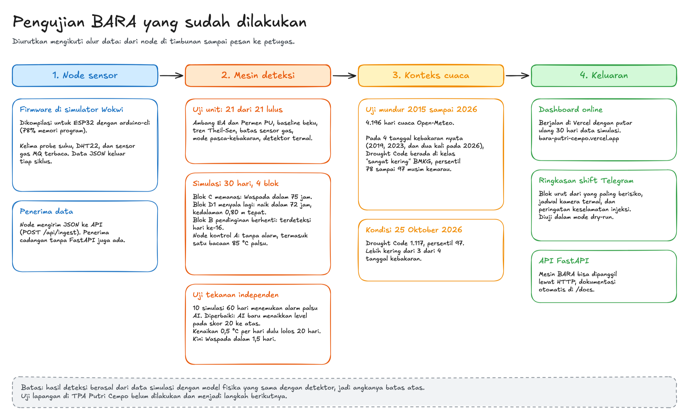

# BARA

**Peringatan dini kebakaran TPA dari dalam timbunan sampah.** BARA menanam probe suhu di timbunan, membaca bara yang tidak terlihat dari permukaan, lalu memberi tahu petugas blok mana yang harus diperiksa pada shift ini.

[](https://bara-putri-cempo.vercel.app)
[](tests/test_risk.py)
[](#status-dan-langkah-berikutnya)
[](requirements.txt)


**[Buka dashboard](https://bara-putri-cempo.vercel.app)** · **[Video lengkap (3 menit)](video/Video_Marketing_BARA.mp4)** · **[Bukti pengujian](#pengujian-yang-sudah-dilakukan)**

Hilmi, https://master-hilmi.vercel.app/

## Masalah

TPA Putri Cempo di Surakarta terbakar besar pada 2019, 2023, dan 2026. Pada 2 September 2026 TPA terbakar dan tanggap darurat berlangsung sampai 16 September. Blok C dan D dinyatakan aman pada 7 September, lalu Blok B, C, D1, dan D2 terbakar lagi pada 24 September (Metro TV, iNews, detikJateng).

Api seperti ini menyala lagi karena bara bertahan di bawah permukaan. Saat ini petugas mencari titik asap secara manual dalam enam shift, lalu menyuntikkan air ke titik yang terlihat berasap. Tidak ada data suhu dari dalam timbunan, jadi panas yang belum mengeluarkan asap tidak terpantau.

Masalah ini tidak hanya terjadi di Solo. KLH mencatat 23 TPA terbakar sepanjang 2026, dan menurut Walhi 312 TPA masih memakai sistem *open dumping*.

## Cara kerja

```
Node di tiap blok                Mesin BARA                         Petugas dan DLH
5 probe suhu, 10 s/d 150 cm  --> Lapisan aturan (EA, Permen PU) --> Dashboard web
DHT22 (udara), sensor gas MQ     Lapisan AI (model termal)          Ringkasan shift Telegram
ESP32, kirim JSON                Indeks cuaca (Drought Code)        Normal, Waspada, Siaga, Awas
```

1. **Node** ditanam di tiap blok. Lima probe suhu mengukur timbunan pada kedalaman 10, 30, 60, 100, dan 150 cm. ESP32 mengirim bacaan sebagai JSON.
2. **Lapisan aturan** memakai ambang yang bisa diperiksa siapa pun: Environment Agency Inggris (SC010066, Tabel 23) dan Permen PU 03/PRT/M/2013. Baseline tiap probe dipelajari sekali lalu dibekukan, sehingga kenaikan pelan tetap tertangkap.
3. **Mode pasca-kebakaran** membandingkan blok bekas terbakar dengan node kontrol di sampah yang tidak terbakar. Jika pendinginan berhenti atau suhu naik melawan kurva pendinginan, BARA menandainya.
4. **Lapisan AI** memodelkan tiap tali probe sebagai kolom sampah yang menghantarkan panas, lalu memperkirakan **kedalaman dan waktu mulai** sumber panas. Model ini berbasis fisika dan tidak butuh data kebakaran untuk belajar.
5. **Keluaran**: dashboard dengan peta, alasan tiap status, dan penampang probe, ditambah ringkasan Telegram di awal tiap shift. Ringkasan itu memuat blok yang diurutkan dari yang paling berisiko, jadwal kamera termal sebelum matahari terbit, dan peringatan keselamatan saat injeksi air.

## Apa bedanya dengan cara lain

| Cara | Yang terlihat | Batasnya |
|---|---|---|
| Inspeksi titik asap | Asap di permukaan | Bara yang belum berasap tidak terlihat |
| Kamera termal genggam | Panas permukaan | EA menilai hasilnya "variable"; siang hari panas matahari menutupi panas dari dalam |
| Satelit (VIIRS) | Api besar | Satu piksel 375 m sekitar 14 ha, padahal TPA hanya sekitar 17 ha |
| **BARA** | **Suhu di dalam timbunan, per kedalaman, tiap jam** | Satu tali probe hanya melihat sekitar 1 sampai 2 m di sekitarnya, jadi node ditaruh di blok berisiko |

BARA melengkapi kamera termal yang direncanakan DLH. Dashboard menunjukkan blok mana yang perlu dipindai, dan bot menjadwalkan pemindaian sebelum matahari terbit, saat panas dari dalam timbunan paling mudah dibedakan.

## Pengujian yang sudah dilakukan



| Uji | Hasil |
|---|---|
| Uji unit | 21 dari 21 tes lulus (`pytest tests`) |
| Simulasi 30 hari, 4 blok | Blok C yang memanas mencapai Waspada dalam 75 jam. Blok D1 yang menyala lagi naik status dalam 72 jam, dan AI memperkirakan kedalaman sumber 0,80 m, sama dengan skenario. Pendinginan yang berhenti di Blok B terdeteksi pada hari ke-16. Node kontrol tidak memberi alarm, termasuk saat ada satu bacaan 85 °C palsu. |
| Uji tekanan independen | Menemukan dua kelemahan, keduanya sudah diperbaiki. Pertama, AI memberi alarm palsu di 8 dari 10 simulasi 60 hari, sehingga kini AI baru menaikkan level pada skor 20 ke atas. Kedua, kenaikan 0,5 °C per hari dulu lolos selama 20 hari, dan kini mencapai Waspada dalam 1,5 hari. |
| Uji mundur cuaca 2015 sampai 2026 | Pada keempat tanggal kebakaran nyata, Drought Code berada di kelas "sangat kering" BMKG dengan persentil 78 sampai 97 musim kemarau |
| Firmware di Wokwi | Dikompilasi untuk ESP32 (78% memori program); kelima probe, DHT22, dan sensor gas terbaca, JSON keluar tiap siklus |
| Ujung ke ujung | Dashboard berjalan online; ringkasan shift Telegram dan API penerima data diuji dalam mode lokal |

Rincian angka ada di [`data/processed/layer_comparison.md`](data/processed/layer_comparison.md) dan [`data/processed/backtest_weather.md`](data/processed/backtest_weather.md). Diagram di atas bisa diubah lewat [`docs/pengujian.excalidraw`](docs/pengujian.excalidraw) di excalidraw.com.

## Kenapa sekarang

Per 25 Oktober 2026, Drought Code di Putri Cempo bernilai 1.117, persentil 97 musim kemarau. Angka ini lebih tinggi dari tiga dari empat tanggal kebakaran yang tercatat. Data Open-Meteo ini hasil reanalisis model, bukan stasiun, tetapi arahnya sejalan dengan laporan BMKG soal El Nino. Risiko kebakaran TPA sedang tinggi.

BARA juga relevan untuk rencana ekstraksi gas TPA tahun 2027 (menurut diskusi tim, perlu dikonfirmasi DLH). Sebelum pipa dipasang, BARA menunjukkan kapan blok bekas terbakar kembali ke suhu latar. Setelah penyedotan dimulai, probe di sekitar sumur memantau pemanasan yang menandai udara masuk ke timbunan.

## Biaya

Satu node sekitar **Rp200.000 sampai Rp400.000**: ESP32, probe suhu DS18B20, DHT22, dan sensor gas MQ. Sebagai pembanding, penanganan dampak kebakaran 2026 diproyeksikan Rp2,3 miliar oleh Ketua DPRD Surakarta.

Perangkat lunaknya memakai layanan gratis: Open-Meteo untuk cuaca, Vercel untuk dashboard, dan Telegram untuk notifikasi.

## Status dan langkah berikutnya

Semua angka deteksi di dashboard dan video berasal dari **data simulasi**. Simulasi itu memakai model fisika yang sama dengan detektor, ditambah pemanasan matahari, hujan, derau, dan drift sensor, jadi hasilnya batas atas. Dashboard, video, dan pesan Telegram selalu memberi label simulasi.

Langkah berikutnya:

1. Izin penelitian dari DLH Surakarta lewat BRIDA, dan tindakan per status yang disesuaikan dengan SOP DLH.
2. Node pertama di blok bekas terbakar sebagai pemantau penyalaan ulang, ditambah satu node kontrol.
3. Casing pipa baja galvanis dan thermocouple untuk blok yang masih panas.
4. Pengumpulan data lapangan untuk mengkalibrasi ulang ambang dan lapisan AI.

## Menjalankan sendiri

Kebutuhan: Python 3.12 dengan [uv](https://github.com/astral-sh/uv), dan Node.js untuk dashboard.

```bash
uv venv -p 3.12 .venv
uv pip install --python .venv/bin/python -r requirements.txt
```

Data, simulasi, dan tes:

```bash
.venv/bin/python data/fetch_weather.py          # cuaca jam 12 siang 2015 sampai sekarang
.venv/bin/python data/backtest_weather.py       # Drought Code dan FFMC, uji mundur pada 4 kebakaran
.venv/bin/python sim/simulate_nodes.py          # data node simulasi (model konduksi, 30 hari)
.venv/bin/python data/run_thermal.py            # lapisan AI dan perbandingan waktu deteksi dengan aturan
.venv/bin/python bot/telegram_alert.py --shift  # ringkasan awal shift (dry-run tanpa token)
.venv/bin/python -m pytest -q tests
```

Dashboard web, di dua terminal:

```bash
.venv/bin/uvicorn api.main:app --port 8000 --reload   # API, dokumentasi di http://localhost:8000/docs
cd web && npm install && npm run dev                   # dashboard di http://localhost:3000
```

Jika API berjalan di alamat lain, set `BARA_API_URL` sebelum `npm run dev`. Node mengirim data ke `POST /api/ingest`.

Opsional:

```bash
TELEGRAM_BOT_TOKEN=... TELEGRAM_CHAT_ID=... .venv/bin/python bot/telegram_alert.py
FIRMS_MAP_KEY=... .venv/bin/python data/fetch_firms.py
```

<details>
<summary>Versi statis dashboard, peran node, dan Wokwi</summary>

**Versi statis.** Dashboard online memakai data simulasi yang dihitung sebelumnya, tanpa server Python:

```bash
.venv/bin/python api/export_static.py           # tulis web/public/data/*.json
cd web && vercel deploy --prod --build-env NEXT_PUBLIC_BARA_STATIC=1
```

**Peran node.** Node di blok bekas terbakar memakai mode pasca-kebakaran dan butuh node kontrol di sampah yang tidak terbakar. Untuk data lapangan, tulis `data/nodes.json`, misalnya:

```json
{"N1": {"mode": "kontrol"}, "N3": {"mode": "pasca_kebakaran", "reference": "N1", "since": "2026-09-24"}}
```

Jam shift untuk ringkasan Telegram ada di `data/shifts.json` (daftar `{"name", "start", "hours"}`). Tanpa file itu dipakai enam shift @ 4 jam mulai 00.00.

**Node di Wokwi.** Buat proyek ESP32 baru di https://wokwi.com, lalu tempel isi `firmware/bara_node/bara_node.ino` ke `sketch.ino`, `wokwi/diagram.json` ke `diagram.json`, dan `wokwi/libraries.txt` ke Library Manager. Ubah suhu probe dengan mengklik sensornya saat simulasi berjalan.

</details>

## Struktur

| Folder | Isi |
|---|---|
| `bara/` | Paket Python: lokasi, lapisan aturan (`risk.py`), lapisan AI (`thermal.py`), cuaca (`weather.py`) |
| `data/` | Skrip unduh dan uji mundur; `raw/` dan `processed/` berisi hasilnya |
| `sim/` | Generator data node simulasi |
| `firmware/`, `wokwi/` | Kode ESP32 dan rangkaian simulasi |
| `api/` | API FastAPI di atas mesin BARA, termasuk penerima data node |
| `ingest/` | Penerima data node cadangan (pustaka standar Python) |
| `web/` | Dashboard web (Next.js, MapLibre) |
| `bot/` | Ringkasan dan peringatan Telegram |
| `tests/` | Tes mesin risiko |
| `docs/` | GIF demo dan diagram pengujian |
| `video/` | Video demo tanpa suara (subtitle, zoom, dan sorotan) |

## Rujukan utama

- Environment Agency (2007), laporan SC010066. Ambang suhu di dalam timbunan, Tabel 23.
- Peraturan Menteri PU No. 03/PRT/M/2013, Lampiran III, Tabel 10. Kelas suhu TPA.
- Open-Meteo Archive API, data cuaca 2015 sampai 2026. Indeks Drought Code dan FFMC dihitung dengan xclim 0.62.0.
